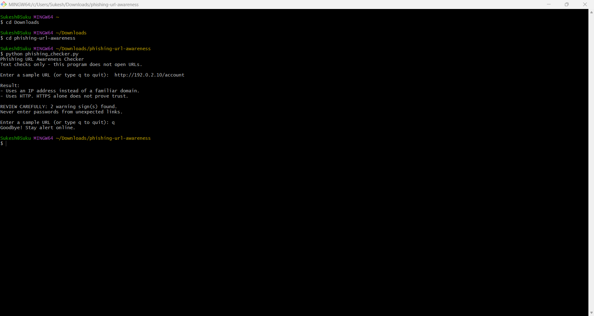
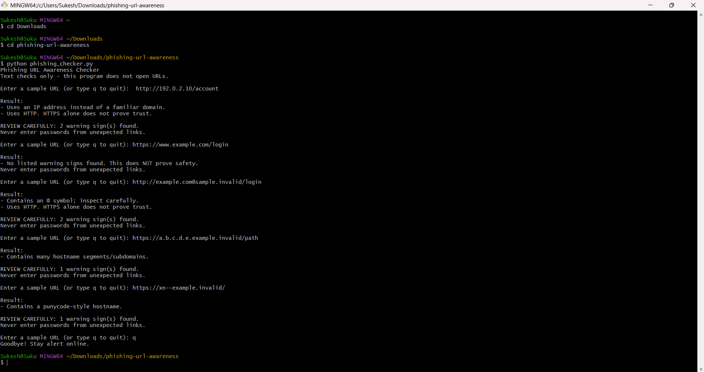

# EWB Phishing URL Awareness Checker

## Overview
Phishing is a trick where criminals send fake links or messages to make people share their passwords, card numbers or OTPs. My tool is a small Python program that reads the text of a URL and points out six visible warning signs, like an @ symbol or an IP address in place of a website name. It never opens the URL, and it only gives clues, not proof.

## Features
- Detects an @ symbol in the URL
- Flags unusually long URLs (over 100 characters)
- Flags IP-address hostnames
- Flags many hostname segments (5 or more)
- Flags punycode-style hostnames (xn--)
- Flags the HTTP scheme
- Loop with quit: check many URLs in one run, and type q, quit or exit to stop
- "Review carefully" summary: shows how many warning signs were found when there are real warnings

## Requirements
Python 3.10 or later. No extra packages.

## How to Run

Windows: ```python phishing_checker.py```

Mac/Linux: ```python3 phishing_checker.py```


## Example Output
```
Phishing URL Awareness Checker
Text checks only - this program does not open URLs.

Enter a sample URL (or type q to quit): http://192.0.2.10/account

Result:
- Uses an IP address instead of a familiar domain.
- Uses HTTP. HTTPS alone does not prove trust.

REVIEW CAREFULLY: 2 warning sign(s) found.
Never enter passwords from unexpected links.

Enter a sample URL (or type q to quit): q
Goodbye! Stay alert online.

```

## Testing
| # | Input | Expected | Actual | Result |
|---|-------|----------|--------|--------|
| 1 | https://www.example.com/login | No warning signs | No listed warning signs found. This does NOT prove safety. | PASS |
| 2 | http://192.0.2.10/account | IP address + HTTP | Uses an IP address instead of a familiar domain. / Uses HTTP. HTTPS alone does not prove trust. | PASS |
| 3 | http://example.com@sample.invalid/login | @ symbol + HTTP | Contains an @ symbol; inspect carefully. / Uses HTTP. HTTPS alone does not prove trust. | PASS |
| 4 | https://a.b.c.d.e.example.invalid/path | Many hostname segments | Contains many hostname segments/subdomains. | PASS |
| 5 | https://xn--example.invalid/ | Punycode-style hostname | Contains a punycode-style hostname. | PASS |

The full table, including my bonus checks, is in `tests/test_samples.md`. I ran all five tests again after adding my two improvements, and they all still PASS.

## Screenshots



## Improvements
1. Loop with quit - Before, the program asked for one URL and then closed, so I had to restart it for every test. Now `main()` uses a `while True` loop that keeps asking for URLs until I type q, quit or exit (capital letters also work). I chose it because it makes testing much faster. I tested it by checking all five sample URLs in one run, then typing q, and also by typing QUIT in capital letters.
2. "Review carefully" summary - I added a small helper function called `has_warnings()` that tells the difference between real warnings and information messages like "No URL entered." When there are real warnings, the program now prints "REVIEW CAREFULLY" with the number of warning signs found. I chose it because the result is easier to understand at a glance. I tested it by re-running all five sample URLs: tests 2 and 3 show a count of 2, tests 4 and 5 show a count of 1, and test 1 and empty input show no summary line.

## Limitations
This is an educational tool. It only reads URL text. It does not visit
URLs, scan for malware or prove that a URL is safe. No warning signs
found does NOT mean a URL is safe.

Known gap: badly formed text such as `http://[bad` still makes the program stop with a ValueError, because I have not added error handling for it yet.

## Ethical Use
Use sample strings only. Do not collect credentials. Do not use this
project to deceive anyone or to test websites without permission.

## Author
Sukesh S, AI POWERED CYBERSECURITY INTERNSHIP, EWB Courses
